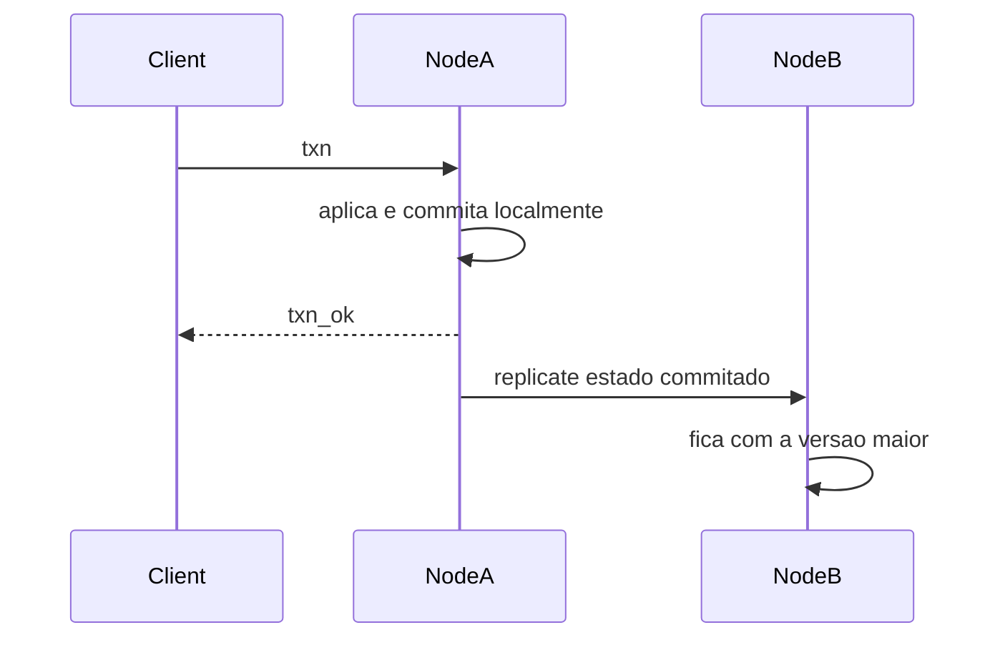

# Estado mutável sincronizado

Um registro chave-valor. Cada transação responde no nó que a recebeu. As réplicas convergem depois. A escolha é disponibilidade total: com a rede cortada, os dois lados continuam respondendo. O que fica de fora é enxergar, na hora, a escrita mais recente do outro lado.

O enunciado do desafio está no [README](../README.md). O estado mora em [lib/store.dart](../lib/store.dart). O protocolo e o gossip moram em [lib/node.dart](../lib/node.dart).

## Protocolo

Maelstrom escreve uma linha JSON no stdin e espera uma linha JSON no stdout. Log vai para o stderr.

`init` devolve `init_ok`. `txn` executa as operações em ordem e devolve `txn_ok`: a leitura volta com o valor observado, a escrita volta igual. Chave que nunca foi escrita vale `null`. Uma escrita no meio da transação vale para as leituras seguintes da mesma transação.

```json
{"src":"c1","dest":"n1","body":{"type":"txn","msg_id":2,"txn":[["r",1,null],["w",1,42],["r",1,null]]}}
```

```json
{"src":"n1","dest":"c1","body":{"type":"txn_ok","in_reply_to":2,"txn":[["r",1,null],["w",1,42],["r",1,42]]}}
```

## Desenho

Cada chave guarda `(timestamp, nodeId, value)`.

O nó tem um relógio de Lamport. Ao receber um gossip, o relógio avança até o relógio remoto. A transação local usa o relógio seguinte em todas as chaves que ela escreve. Empate de timestamp fica com o `nodeId` maior, sempre na mesma direção.

A fusão guarda, para cada chave, a versão maior. A mesma mensagem pode chegar de novo. Uma mensagem atrasada não apaga um valor mais novo.

A transação atualiza o mapa local, responde ao cliente e só então publica. O que segue na rede é o valor final de cada chave. Se a transação escreve a mesma chave duas vezes, a outra réplica nunca vê o primeiro valor.

Há dois envios. Um imediato, com as chaves que esta transação acabou de commitar. Outro periódico, com o mapa inteiro, para repor mensagem perdida no corte da rede.

O protocolo tem um erro `30` (`txn-conflict`) para abortar. Este nó não aborta. Abortar para evitar conflito durante a partição seria deixar de responder.



## Nível 1 — um nó

O mapa local basta. Não há par para quem enviar.

Garantia: as operações de uma transação acontecem em ordem, e a transação seguinte lê o que a anterior commitou neste nó.

O que não entra aqui: réplica, falha de rede, outro nó.

## Nível 2 — duas réplicas, sem partição

A resposta não espera o outro nó. O gossip leva as escritas commitadas. Duplicata e reordenação são inofensivas por causa da fusão por versão.

Garantia: os dois nós aceitam transações ao mesmo tempo, e uma escrita acaba visível no outro quando a mensagem chega.

O que não prometemos: a leitura enxergar uma escrita que o outro nó já confirmou e ainda não replicou. Read-uncommitted não exige tempo real. Essa leitura obsoleta é parte do modelo.

## Nível 3 — partição

O nó isolado continua commitando no mapa local. A mensagem enviada durante o corte pode ser descartada. Quando a rede volta, o gossip periódico reenvia o mapa inteiro. Chaves diferentes se somam. A mesma chave fica com a versão maior.

Garantia: disponibilidade dos dois lados durante o corte, e o mesmo mapa quando os dois voltam a se falar.

O que não prometemos: um único vencedor escolhido enquanto os nós estão separados. Os dois podem confirmar valores diferentes para a mesma chave. A convergência é depois.

## Nível 4 — read-committed

Read-committed continua compatível com disponibilidade total. Ele proíbe leitura suja, não a leitura atrasada.

O desenho cobre as anomalias assim:

- G0, escrita suja em ciclo: um timestamp por transação. Duas transações não se sobrescrevem em ordem cruzada nas chaves que escreveram juntas.
- G1a, leitura de transação abortada: não abortamos. Toda transação que respondeu `txn_ok` commitou.
- G1b, leitura intermediária: a rede só carrega o valor final da chave naquela transação.
- G1c, fluxo circular: uma transação só lê estado já commitado, e a escrita dela só fica visível depois desse commit. T1 não consegue ler a escrita de T2 se T2 leu a escrita de T1.

O que não prometemos, e é o fecho da conversa: linearizabilidade. Sob partição, os dois lados confirmam escritas ao mesmo tempo, e uma leitura pode não ver a escrita mais recente do outro lado. Esperar a outra réplica para "ler o último valor do cluster" quebra a disponibilidade no momento em que a rede corta. É o limite do CAP. Read-committed cabe. Tempo real, não.

## Como mostrar

Testes de unidade, na ordem dos níveis:

```bash
dart test
```

Maelstrom, um nível por vez. O script baixa o release v0.2.4 em `.maelstrom/` na primeira execução e compila `build/maelstrom-txn`. É preciso um JDK no PATH. O checker também usa `gnuplot` para os gráficos de latência; sem ele o resultado fica indefinido mesmo quando não há anomalia. `dot` (Graphviz) entra só se o checker for desenhar um ciclo.

```bash
./tool/test-level.sh 1
./tool/test-level.sh 2
./tool/test-level.sh 3
./tool/test-level.sh 4
```

Os comandos são os do enunciado: nível 1 com um nó e read-uncommitted; nível 2 com dois nós; nível 3 com partição e disponibilidade total; nível 4 com read-committed, partição e disponibilidade total.
